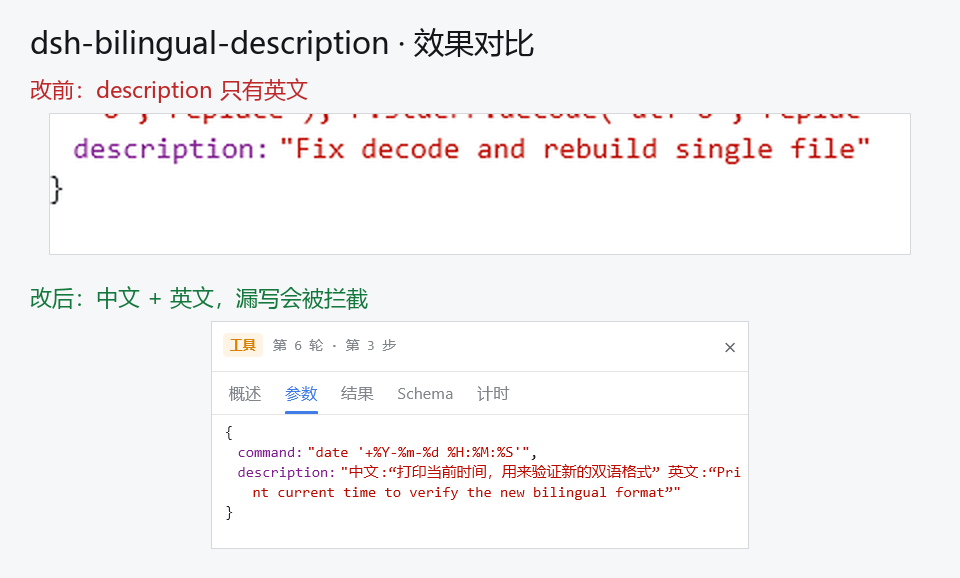
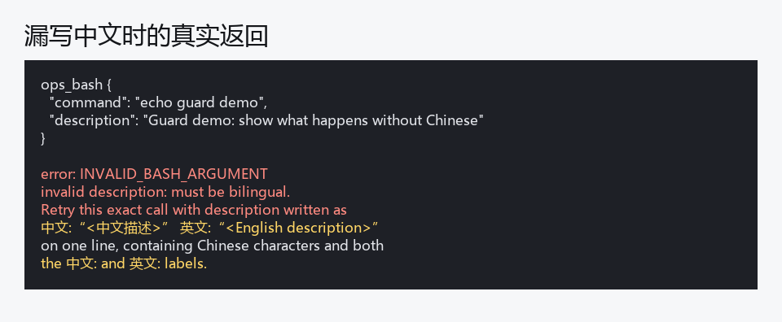

# dsh-bilingual-description

Every tool call that takes a `description` argument writes it **bilingual — Chinese first, English second** — and a call that forgets the Chinese half is rejected before it runs, with the exact rewrite handed back to the model.



## Why

Tool-call `description` is the sentence you read in the trajectory **参数** panel to remember what a call did. English-only descriptions are fast to skim but hard to scan for non-English readers, and they silently become the project's audit trail.

There is no translation layer to bolt on: the value is produced by the model, stored verbatim in the session record, and never rewritten afterwards. So the only two places that can influence it are the **prompt** (say the rule) and the **guard** (refuse the call). This plugin does both.

## What it does

1. **Prompt section** — a short rule is appended to the system prompt of every agent, next to the built-in shell guidance, so the model knows the format *before* it writes.
2. **Tool guard** — before a call executes, `description` is checked. On failure the call is denied and the model receives the exact retry text, so the next attempt is correct.

Required format (one line, full-width quotes so nothing needs JSON escaping):

```
中文:“<中文描述>” 英文:“<English description>”
```



## Scope

- Only tools that actually declare a top-level `description` parameter are checked; the plugin reads the tool definition at call time, so it follows whatever the installed tools expose.
- If the definition cannot be read, it falls back to a known shell-tool list instead of guessing broadly.
- `read`, `write` and similar tools without a `description` parameter are untouched.
- Every failure inside the plugin results in **allow** — it can never block a call for its own reasons.

## Configuration

All optional, via environment variables:

| Variable | Default | Meaning |
| --- | --- | --- |
| `DSH_BILINGUAL_DESCRIPTION_DISABLE` | unset | Set to `1` to turn the plugin off entirely. |
| `DSH_BILINGUAL_DESCRIPTION_SCOPE` | `all` | `shell` restricts checks to command-style tools only. |
| `DSH_BILINGUAL_DESCRIPTION_EXTRA_TOOLS` | unset | Comma-separated extra tool names to enforce when the schema is unavailable. |

The wording lives at the top of `index.js` (`CN_LABEL` / `EN_LABEL` / `RULE` / message builders) if you want a different language pair or separator.

## Install

From the DSH plugin market: install `dsh-bilingual-description`.

Manually, into a profile:

```bash
cd ~/.dsh/profiles/<profile>
npm install /path/to/dsh-plugin-bilingual-description
```

then add `"dsh-bilingual-description"` to `dsh.profile.bundles` in that profile's `package.json` and restart DSH.

Verify with a tool call that has an English-only description — it should be rejected with `invalid description: must be bilingual`.

## Development

```bash
node scripts/smoke.mjs   # 16 assertions, no DSH runtime needed
node --check index.js
```

## Compatibility

- DeepSeek Harness `>= 0.2.0-rc.1` (tested on `0.2.2-rc.1`).
- No dependency on any other plugin; it only uses `ctx.systemPrompt.section()` and `ctx.tools.guard()`.

## License

MIT
