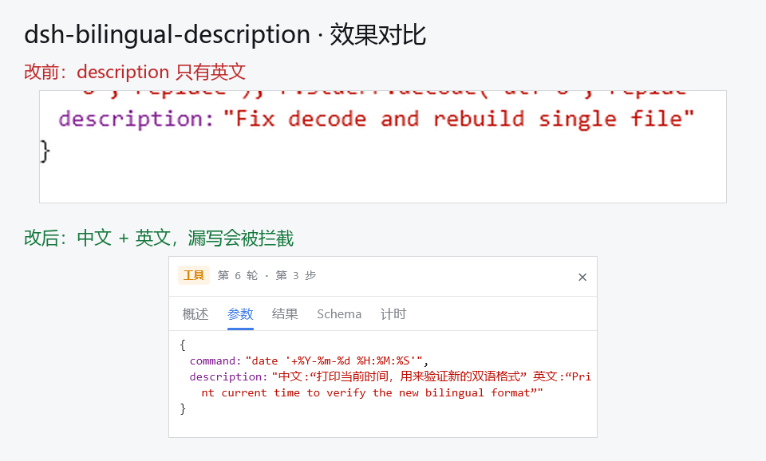
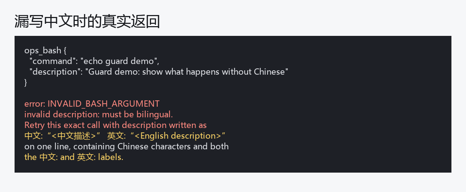

# dsh-bilingual-description

让每个带 `description` 参数的工具调用都写成**中文在前、英文在后**的双语描述；漏写中文的调用会在执行前被拦下，并把准确的改法原样丢回给模型重写。



## 为什么需要它

工具调用的 `description` 就是轨迹「参数」面板里那一句话，是你事后回看「这一步到底干了什么」的唯一线索。只写英文时，中文读者扫起来更慢；而这条记录一旦写进会话就是**不可变快照**，事后没有任何插件能把它翻译回去。

所以能改变它的只有两个位置——**提示词**（事先讲规则）和**守卫**（写错就不让跑）。本插件两处都做。

## 它做什么

1. **提示词段落**：在每次请求的系统提示里追加一条短规则，位置紧挨内置的 shell 指引，让模型在**动笔之前**就知道格式。
2. **调用守卫**：调用执行前检查 `description`。不合格就拒绝该次调用，并把重写要求原样返回，模型下一次就能写对。

要求的格式（单行、全角引号，因此不需要任何 JSON 转义）：

```
中文:“<中文描述>” 英文:“<English description>”
```



## 作用范围

- 只校验**真的声明了顶层 `description` 参数**的工具：插件在调用时读取工具定义，所以它跟随当前安装的工具，不硬编码工具名。
- 读不到工具定义时，退回一份命令类工具名单，不扩大打击面。
- `read`、`write` 之类没有 `description` 参数的工具完全不受影响。
- 插件内部任何异常都按**放行**处理：它不会因为自己的原因拦住正常调用。

## 配置

全部可选，用环境变量：

| 变量 | 默认 | 含义 |
| --- | --- | --- |
| `DSH_BILINGUAL_DESCRIPTION_DISABLE` | 未设置 | 设为 `1` 彻底关闭本插件。 |
| `DSH_BILINGUAL_DESCRIPTION_SCOPE` | `all` | 设为 `shell` 时只校验命令类工具。 |
| `DSH_BILINGUAL_DESCRIPTION_EXTRA_TOOLS` | 未设置 | 逗号分隔的额外工具名（读不到 schema 时强制校验）。 |

想换语言对或分隔符，改 `index.js` 顶部的 `CN_LABEL` / `EN_LABEL` / `RULE` 即可。

## 安装

插件市场安装：搜索 `dsh-bilingual-description`。

手动装进某个 profile：

```bash
cd ~/.dsh/profiles/<profile>
npm install /path/to/dsh-plugin-bilingual-description
```

然后在该 profile 的 `package.json` 里把 `"dsh-bilingual-description"` 加进 `dsh.profile.bundles`，重启 DSH。

验证：随便发一条只写英文 `description` 的工具调用，应当收到 `invalid description: must be bilingual`。

## 开发与自测

```bash
node scripts/smoke.mjs   # 16 条断言，不需要 DSH 运行时
node --check index.js
```

## 兼容性

- DeepSeek Harness `>= 0.2.0-rc.1`（在 `0.2.2-rc.1` 上实测）。
- 不依赖任何其它插件，只使用 `ctx.systemPrompt.section()` 与 `ctx.tools.guard()` 两个公开扩展点。

## 许可证

MIT
